# 🏨 HostelHub – Room Allotment Management System

[](https://nodejs.org/)
[](https://expressjs.com/)
[](https://www.sqlite.org/)
[](https://hostelhub-cjlu.onrender.com/)
[](test.js)
[](HostelHub-Postman-Collection.json)

Robust, production-ready backend REST API for **HostelHub**, a room allotment management system designed to eliminate manual, paper-based room allocation for hostel wardens.

> **Client Brief (Theme 10 of 30 · Room allotment):**  
> *"Rooms are allotted from a paper file. The warden cannot quickly tell which rooms are free in each block. Please build us a system that fixes this."*

---

## 📑 Table of Contents

- [Client Brief & Solution Highlights](#-client-brief--solution-highlights)
- [Live Deployment Links](#-live-deployment-links)
- [Project Directory Structure](#-project-directory-structure)
- [Getting Started & Installation](#-getting-started--installation)
- [Database Schema & Relational Design](#-database-schema--relational-design)
- [REST API Reference](#-rest-api-reference)
- [Client Brief Twist Rule: Status Flow](#-client-brief-twist-rule-status-flow)
- [Live Browser Path Navigation Proofs (Part A)](#-live-browser-path-navigation-proofs-part-a)
- [Postman API Test Execution Proofs (Part B)](#-postman-api-test-execution-proofs-part-b)
- [Postman Collection Setup & Usage](#-postman-collection-setup--usage)
- [Automated Testing Suite](#-automated-testing-suite)
- [Assessment Hand-in Checklist](#-assessment-hand-in-checklist)

---

## 🎯 Client Brief & Solution Highlights

- **Instant Block Filtering**: Wardens can query room availability by hostel block (`GET /rooms?block=Block%20A`) using case-insensitive SQL matching.
- **Relational SQL JOIN**: Connects residents and rooms through allotments (`GET /allotments`), projecting resident names, roll numbers, departments, room names, and room blocks in a single query.
- **Twist Rule State Machine**: Enforces strict status transition lifecycle (`pending` → `approved` → `done`). Any backwards or illegal transition is rejected with HTTP `400 Bad Request` and exact message `"Invalid status change"`.
- **Foreign Key Integrity**: Enforces SQLite `PRAGMA foreign_keys = ON;` and `RESTRICT` deletion rules to preserve referential consistency.
- **Production Deployment**: Hosted live on Render with full CORS support, health checking, and structured error responses.

---

## 🌐 Live Deployment Links

The API is deployed and accessible on Render:

| Resource | HTTP Method | Live Endpoint URL | Description |
|---|:---:|---|---|
| **Root Welcome** | `GET` | [`https://hostelhub-cjlu.onrender.com/`](https://hostelhub-cjlu.onrender.com/) | API metadata, theme overview & quick links |
| **Health Check** | `GET` | [`https://hostelhub-cjlu.onrender.com/health`](https://hostelhub-cjlu.onrender.com/health) | Uptime monitoring endpoint |
| **All Rooms** | `GET` | [`https://hostelhub-cjlu.onrender.com/rooms`](https://hostelhub-cjlu.onrender.com/rooms) | Full list of hostel rooms |
| **Search by Block** | `GET` | [`https://hostelhub-cjlu.onrender.com/rooms?block=Block%20A`](https://hostelhub-cjlu.onrender.com/rooms?block=Block%20A) | Case-insensitive room search by block |
| **Single Room** | `GET` | [`https://hostelhub-cjlu.onrender.com/rooms/1`](https://hostelhub-cjlu.onrender.com/rooms/1) | Fetch single room record by ID |
| **All Residents** | `GET` | [`https://hostelhub-cjlu.onrender.com/residents`](https://hostelhub-cjlu.onrender.com/residents) | Full list of registered student residents |
| **Single Resident** | `GET` | [`https://hostelhub-cjlu.onrender.com/residents/1`](https://hostelhub-cjlu.onrender.com/residents/1) | Fetch single resident by ID |
| **Allotments (SQL JOIN)** | `GET` | [`https://hostelhub-cjlu.onrender.com/allotments`](https://hostelhub-cjlu.onrender.com/allotments) | Relational 3-table SQL JOIN result |
| **Single Allotment** | `GET` | [`https://hostelhub-cjlu.onrender.com/allotments/1`](https://hostelhub-cjlu.onrender.com/allotments/1) | Fetch single joined allotment by ID |

---

## 📁 Project Directory Structure

```text
HostelHub/
│
├── app.js                              # Express application setup, route mounting & error handling
├── database.js                         # SQLite connection manager, schema DDL, seeds & query helpers
├── routes/
│   ├── rooms.js                        # Rooms CRUD + block query search + input validation
│   ├── residents.js                    # Residents REST API endpoints
│   └── allotments.js                   # Allotments REST API + JOIN endpoints + Twist status flow
├── test.js                             # Comprehensive automated test suite (40 passing tests)
├── package.json                        # Project metadata, dependencies, and npm scripts
├── package-lock.json                   # Dependency lockfile
├── .gitignore                          # Excludes node_modules, *.db, *.sqlite, .env, .DS_Store
├── screenshots/                        # Live browser navigation execution proofs (Routes 01-11)
│   ├── 01-browser-root.png
│   ├── 02-browser-health.png
│   ├── 03-browser-rooms.png
│   ├── 04-browser-rooms-search.png
│   ├── 05-browser-room-by-id.png
│   ├── 06-browser-residents.png
│   ├── 07-browser-resident-by-id.png
│   ├── 08-browser-allotments-join.png
│   ├── 09-browser-allotment-by-id.png
│   ├── 10-browser-rooms-404.png
│   └── 11-browser-route-404.png
├── postman-screenshots/                # Postman API test execution proofs (Tests 01-07)
│   ├── postman-health.png
│   ├── postman-allotments-join.png
│   ├── 12-postman-create-room.png
│   ├── 13-postman-create-allotment-twist1.png
│   ├── 14-postman-approve-allotment-twist2.png
│   ├── 15-postman-invalid-status-twist3.png
│   ├── 16-postman-validation-error.png
│   └── HostelHub-Postman-Collection.json
├── HostelHub-Postman-Collection.json   # Exported Postman Collection (v2.1.0)
└── README.md                           # Complete project guide and API documentation
```

---

## 🚀 Getting Started & Installation

### 1. Prerequisites
- **Node.js** (v18.x or later)
- **npm** (v9.x or later)

### 2. Installation
Clone the repository and install dependencies:
```bash
git clone https://github.com/venkateswararaochevala2-cpu/HostelHub.git
cd HostelHub
npm install
```

### 3. Run the Server
- **Production mode:**
  ```bash
  npm start
  ```
- **Development mode (with auto-reload):**
  ```bash
  npm run dev
  ```
The server starts locally at `http://localhost:3000`.

### 4. Run Automated Tests
```bash
npm test
```
Executes all 40 automated test scenarios across health, CRUD, block query filtering, relational joins, and Twist Rule status state transitions.

---

## 🗄️ Database Schema & Relational Design

The database is built on **SQLite** with foreign key constraints strictly enabled (`PRAGMA foreign_keys = ON;`).

### Entity Relationship (ER) Diagram

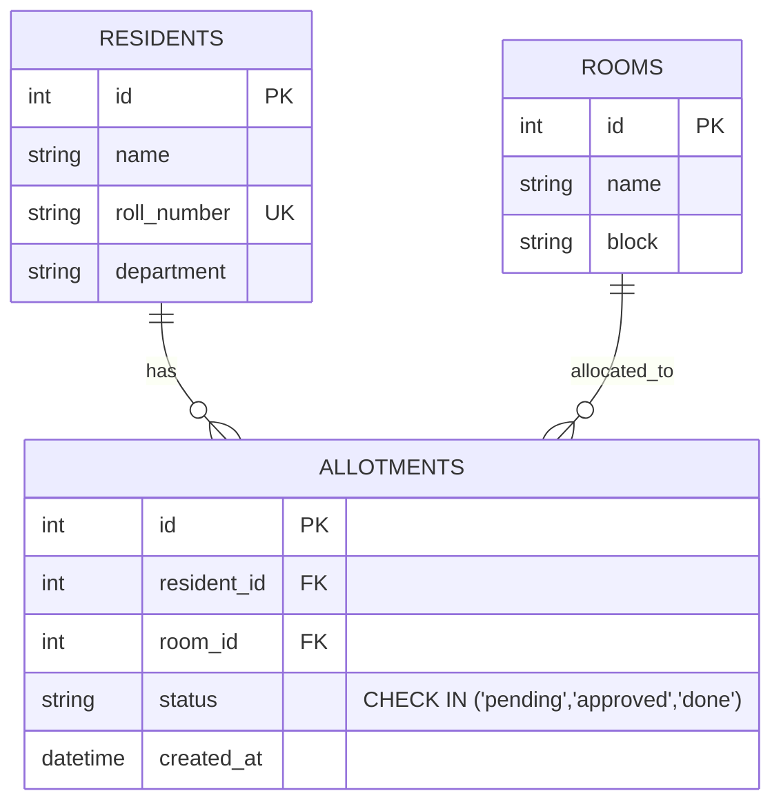

### Table Definitions (DDL)

#### 1. `residents` Table
Stores student resident demographic and registration details:
```sql
CREATE TABLE IF NOT EXISTS residents (
  id INTEGER PRIMARY KEY AUTOINCREMENT,
  name TEXT NOT NULL,
  roll_number TEXT NOT NULL UNIQUE,
  department TEXT NOT NULL
);
```

#### 2. `rooms` Table
Stores hostel rooms with a composite unique constraint per block to prevent duplicates:
```sql
CREATE TABLE IF NOT EXISTS rooms (
  id INTEGER PRIMARY KEY AUTOINCREMENT,
  name TEXT NOT NULL,
  block TEXT NOT NULL,
  UNIQUE(name, block)
);
```

#### 3. `allotments` Table
Links residents to rooms with foreign key constraints and checked status values:
```sql
CREATE TABLE IF NOT EXISTS allotments (
  id INTEGER PRIMARY KEY AUTOINCREMENT,
  resident_id INTEGER NOT NULL,
  room_id INTEGER NOT NULL,
  status TEXT NOT NULL DEFAULT 'pending' CHECK(status IN ('pending', 'approved', 'done')),
  created_at DATETIME DEFAULT CURRENT_TIMESTAMP,
  FOREIGN KEY (resident_id) REFERENCES residents(id) ON DELETE RESTRICT,
  FOREIGN KEY (room_id) REFERENCES rooms(id) ON DELETE RESTRICT
);
```

---

## 📡 REST API Reference

### 1. Rooms API (`/rooms`)

| Method | Endpoint | Description | Status Codes |
|:---:|---|---|:---:|
| `GET` | `/rooms` | Get all rooms | `200`, `500` |
| `GET` | `/rooms?block=Block%20A` | Filter rooms by block query string (case-insensitive) | `200`, `400`, `500` |
| `GET` | `/rooms/:id` | Get single room by ID | `200`, `400`, `404`, `500` |
| `POST` | `/rooms` | Create a new room (`name`, `block` required) | `201`, `400`, `409`, `500` |
| `PUT` | `/rooms/:id` | Update an existing room | `200`, `400`, `404`, `409`, `500` |
| `DELETE` | `/rooms/:id` | Delete a room by ID | `200`, `400`, `404`, `409`, `500` |

#### Example: Search Rooms by Block
- **Request:** `GET /rooms?block=Block A`
- **Response (200 OK):**
  ```json
  [
    {
      "id": 1,
      "name": "Room 101",
      "block": "Block A"
    },
    {
      "id": 2,
      "name": "Room 102",
      "block": "Block A"
    }
  ]
  ```

---

### 2. Residents API (`/residents`)

| Method | Endpoint | Description | Status Codes |
|:---:|---|---|:---:|
| `GET` | `/residents` | Get all residents | `200`, `500` |
| `GET` | `/residents/:id` | Get single resident by ID | `200`, `400`, `404`, `500` |
| `POST` | `/residents` | Create new resident (`name`, `roll_number`, `department`) | `201`, `400`, `409`, `500` |
| `PUT` | `/residents/:id` | Update an existing resident | `200`, `400`, `404`, `409`, `500` |
| `DELETE` | `/residents/:id` | Delete resident by ID | `200`, `400`, `404`, `409`, `500` |

---

### 3. Allotments & Relational SQL JOIN API (`/allotments`)

> **Client Brief Specification:**  
> *"One join endpoint: allotments with the resident name and the room name."*

#### SQL JOIN Implementation:
```sql
SELECT 
  allotments.id,
  allotments.resident_id,
  residents.name AS resident_name,
  residents.roll_number,
  residents.department,
  allotments.room_id,
  rooms.name AS room_name,
  rooms.block AS room_block,
  allotments.status,
  allotments.created_at
FROM allotments
JOIN residents ON allotments.resident_id = residents.id
JOIN rooms ON allotments.room_id = rooms.id;
```

#### Endpoints:
| Method | Endpoint | Description | Status Codes |
|:---:|---|---|:---:|
| `GET` | `/allotments` | Get all allotments with resident & room JOIN details | `200`, `500` |
| `GET` | `/allotments/details` | Explicit JOIN details endpoint | `200`, `400`, `500` |
| `GET` | `/allotments/details/:id`| Get single allotment with full JOIN details | `200`, `400`, `404`, `500` |
| `GET` | `/allotments/:id` | Get single allotment record | `200`, `400`, `404`, `500` |
| `POST` | `/allotments` | Create allotment (automatically starts as `pending`) | `201`, `400`, `404`, `500` |
| `PATCH` | `/allotments/:id/status`| Progress status 1 step forward (Twist Rule) | `200`, `400`, `404`, `500` |
| `DELETE` | `/allotments/:id` | Remove an allotment record | `200`, `400`, `404`, `500` |

---

## 🌪️ Client Brief Twist Rule: Status Flow

> **Card Requirement:**  
> *"Every allotment has a status: pending, approved or done. PATCH /allotments/:id/status may only move it one step forward. Any other move gets 400 and the message 'Invalid status change'."*

### State Transition Diagram

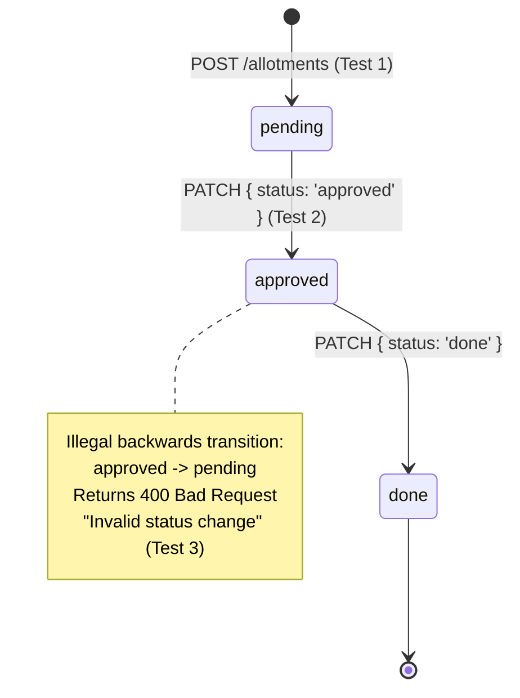

### Transition Matrix

| Current Status | Requested Status | Result | HTTP Status | Response Payload |
|---|---|:---:|:---:|---|
| *(new)* | `pending` | **Allowed** | `201 Created` | Initial state on allotment creation |
| `pending` | `approved` | **Allowed** | `200 OK` | `{ "message": "Status updated successfully", ... }` |
| `approved` | `done` | **Allowed** | `200 OK` | `{ "message": "Status updated successfully", ... }` |
| `pending` | `done` | **Blocked** | `400 Bad Request` | `{ "error": "Invalid status change" }` |
| `approved` | `pending` | **Blocked** | `400 Bad Request` | `{ "error": "Invalid status change" }` |
| `done` | `pending` / `approved` | **Blocked** | `400 Bad Request` | `{ "error": "Invalid status change" }` |

---

## 📸 Live Browser Path Navigation Proofs (Part A)

All endpoints below were executed directly against the live Render deployment (`https://hostelhub-cjlu.onrender.com`).

### Browser Proofs Quick Index
- [01. Root Welcome (`GET /`)](#01-root-welcome--api-directory-get-)
- [02. Health Check (`GET /health`)](#02-uptime-health-check-get-health)
- [03. All Rooms List (`GET /rooms`)](#03-all-rooms-list-get-rooms)
- [04. Search Rooms by Block (`GET /rooms?block=Block A`)](#04-search-rooms-by-block-query-get-roomsblockblock-a)
- [05. Single Room by ID (`GET /rooms/1`)](#05-single-room-by-id-get-rooms1)
- [06. All Residents List (`GET /residents`)](#06-all-residents-list-get-residents)
- [07. Single Resident by ID (`GET /residents/1`)](#07-single-resident-by-id-get-residents1)
- [08. Relational SQL JOIN (`GET /allotments`)](#08-relational-sql-join-allotments-get-allotments)
- [09. Single Allotment Details (`GET /allotments/1`)](#09-single-allotment-details-by-id-get-allotments1)
- [10. Room Not Found 404 (`GET /rooms/999`)](#10-non-existent-room-error-handling-get-rooms999)
- [11. Catch-All Route 404 (`GET /unknown-route`)](#11-catch-all-route-404-handling-get-unknown-route)

---

#### 01. Root Welcome & API Directory (`GET /`)
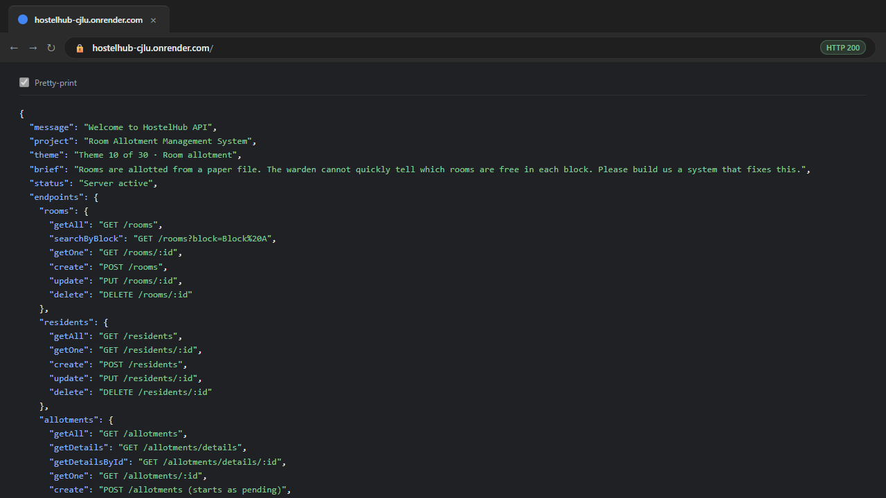
- **Live URL:** [`https://hostelhub-cjlu.onrender.com/`](https://hostelhub-cjlu.onrender.com/)
- **HTTP Method:** `GET` | **Status Code:** `200 OK`
- **Description:** Root discovery endpoint displaying application name, client brief theme description, server status, and navigation links.

---

#### 02. Uptime Health Check (`GET /health`)

- **Live URL:** [`https://hostelhub-cjlu.onrender.com/health`](https://hostelhub-cjlu.onrender.com/health)
- **HTTP Method:** `GET` | **Status Code:** `200 OK`
- **Description:** Health check monitoring endpoint confirming that the service is operational.

---

#### 03. All Rooms List (`GET /rooms`)

- **Live URL:** [`https://hostelhub-cjlu.onrender.com/rooms`](https://hostelhub-cjlu.onrender.com/rooms)
- **HTTP Method:** `GET` | **Status Code:** `200 OK`
- **Description:** Returns JSON array of all hostel rooms with IDs, names, and blocks.

---

#### 04. Search Rooms by Block Query (`GET /rooms?block=Block A`)
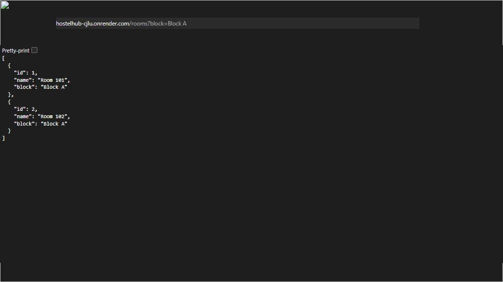
- **Live URL:** [`https://hostelhub-cjlu.onrender.com/rooms?block=Block%20A`](https://hostelhub-cjlu.onrender.com/rooms?block=Block%20A)
- **HTTP Method:** `GET` | **Status Code:** `200 OK`
- **Description:** **Client Brief requirement** — Case-insensitive search filtering rooms that belong specifically to `Block A`.

---

#### 05. Single Room by ID (`GET /rooms/1`)

- **Live URL:** [`https://hostelhub-cjlu.onrender.com/rooms/1`](https://hostelhub-cjlu.onrender.com/rooms/1)
- **HTTP Method:** `GET` | **Status Code:** `200 OK`
- **Description:** Retrieves details for room primary key `1` (`Room 101`, `Block A`).

---

#### 06. All Residents List (`GET /residents`)
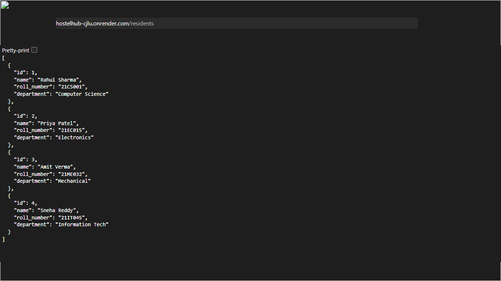
- **Live URL:** [`https://hostelhub-cjlu.onrender.com/residents`](https://hostelhub-cjlu.onrender.com/residents)
- **HTTP Method:** `GET` | **Status Code:** `200 OK`
- **Description:** Returns the registered list of student residents with names, roll numbers, and academic departments.

---

#### 07. Single Resident by ID (`GET /residents/1`)

- **Live URL:** [`https://hostelhub-cjlu.onrender.com/residents/1`](https://hostelhub-cjlu.onrender.com/residents/1)
- **HTTP Method:** `GET` | **Status Code:** `200 OK`
- **Description:** Fetches resident profile by ID (`Rahul Sharma`, Roll `21CS001`, Dept `Computer Science`).

---

#### 08. Relational SQL JOIN: Allotments (`GET /allotments`)

- **Live URL:** [`https://hostelhub-cjlu.onrender.com/allotments`](https://hostelhub-cjlu.onrender.com/allotments)
- **HTTP Method:** `GET` | **Status Code:** `200 OK`
- **Description:** **Client Brief Core requirement** — Relational multi-table SQL JOIN querying allotments together with `resident_name`, `roll_number`, `room_name`, and `room_block`.

---

#### 09. Single Allotment Details by ID (`GET /allotments/1`)
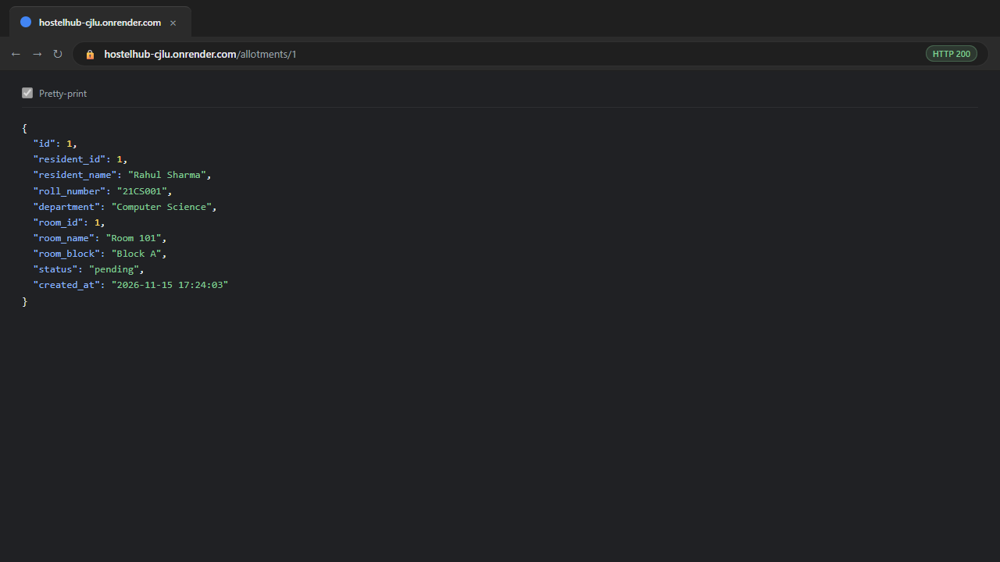
- **Live URL:** [`https://hostelhub-cjlu.onrender.com/allotments/1`](https://hostelhub-cjlu.onrender.com/allotments/1)
- **HTTP Method:** `GET` | **Status Code:** `200 OK`
- **Description:** Retrieves joined relational details for allotment ID `1`.

---

#### 10. Non-Existent Room Error Handling (`GET /rooms/999`)

- **Live URL:** [`https://hostelhub-cjlu.onrender.com/rooms/999`](https://hostelhub-cjlu.onrender.com/rooms/999)
- **HTTP Method:** `GET` | **Status Code:** `404 Not Found`
- **Description:** Structured 404 response when querying a non-existent room ID: `{"error": "Room with ID 999 not found"}`.

---

#### 11. Catch-All Route 404 Handling (`GET /unknown-route`)

- **Live URL:** [`https://hostelhub-cjlu.onrender.com/unknown-route`](https://hostelhub-cjlu.onrender.com/unknown-route)
- **HTTP Method:** `GET` | **Status Code:** `404 Not Found`
- **Description:** Global unmapped route catch-all returning clear JSON error response.

---

## 📮 Postman API Test Execution Proofs (Part B)

The Postman desktop execution proofs below demonstrate full API verification including resource mutations, the relational SQL JOIN endpoint, input validation errors, and the complete Client Brief Twist Rule state machine tests.

### Postman Proofs Quick Index
- [P-01. Health Check Endpoint Verification (`GET /health`)](#p-01-postman-health-check-endpoint-verification-get-health)
- [P-02. SQL JOIN Allotments Verification (`GET /allotments`)](#p-02-postman-sql-join-allotments-verification-get-allotments)
- [P-03. Create New Room (`POST /rooms`)](#p-03-postman-create-new-room-post-rooms)
- [P-04. Twist Test 1: Allotment Initialized to Pending (`POST /allotments`)](#p-04-twist-test-1-create-allotment-starts-as-pending-post-allotments)
- [P-05. Twist Test 2: Progress Status Forward (`PATCH /allotments/:id/status`)](#p-05-twist-test-2-progress-status-pending--approved-patch-allotmentsidstatus)
- [P-06. Twist Test 3: Reject Backwards Transition (`PATCH /allotments/:id/status`)](#p-06-twist-test-3-reject-backwards-status-transition-approved--pending-patch-allotmentsidstatus)
- [P-07. Input Validation Error Handling (`POST /rooms`)](#p-07-postman-input-validation-error-handling-post-rooms)

---

#### P-01. Postman Health Check Endpoint Verification (`GET /health`)
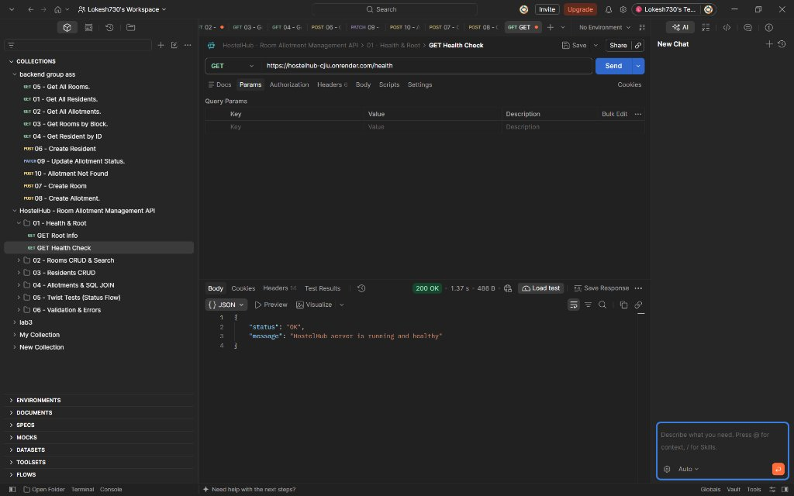
- **Target URL:** `https://hostelhub-cjlu.onrender.com/health`
- **HTTP Method:** `GET` | **Status Code:** `200 OK`
- **Response Body:**
  ```json
  {
    "status": "OK",
    "message": "HostelHub server is running and healthy"
  }
  ```
- **Verification:** Verifies server uptime and JSON header delivery via Postman.

---

#### P-02. Postman SQL JOIN Allotments Verification (`GET /allotments`)
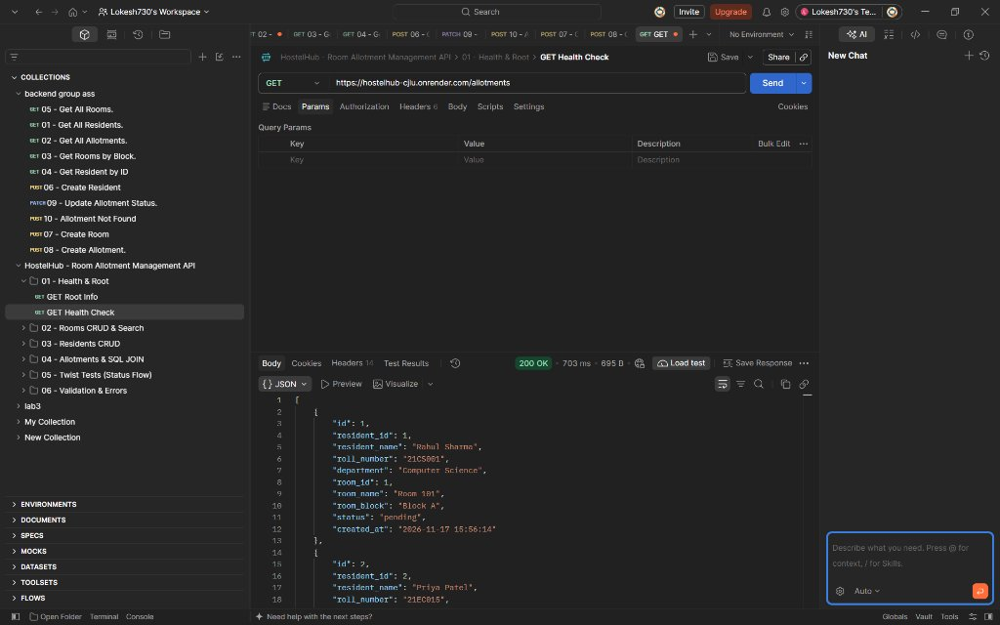
- **Target URL:** `https://hostelhub-cjlu.onrender.com/allotments`
- **HTTP Method:** `GET` | **Status Code:** `200 OK`
- **Response Details:** Returns complete array of allotments containing joined `resident_name`, `roll_number`, `department`, `room_name`, and `room_block`.
- **Verification:** Proves the relational join requirement operates correctly in Postman against the live Render API.

---

#### P-03. Postman Create New Room (`POST /rooms`)
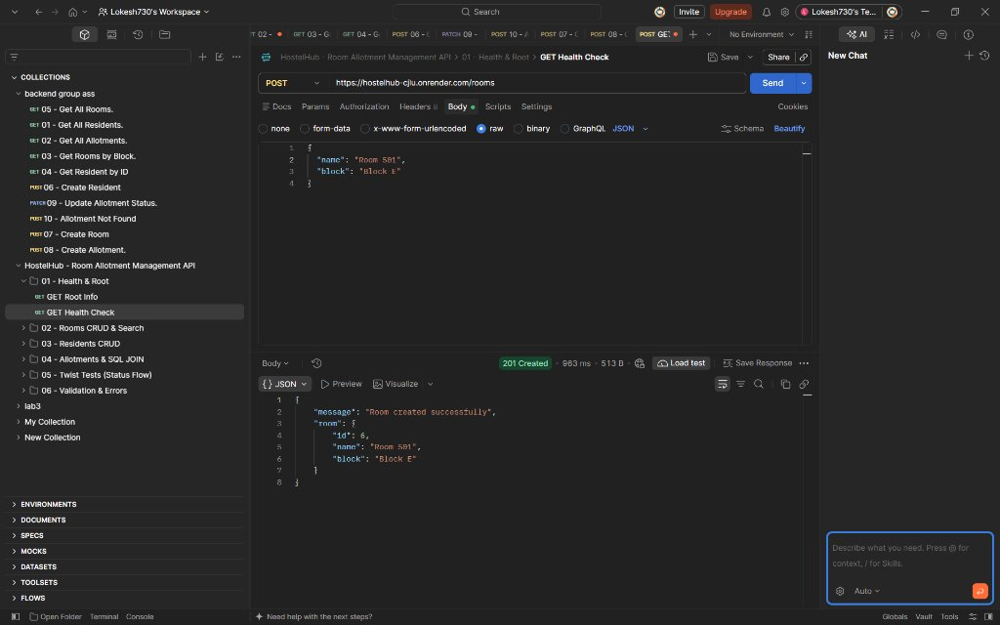
- **Target URL:** `https://hostelhub-cjlu.onrender.com/rooms`
- **HTTP Method:** `POST` | **Status Code:** `201 Created`
- **Request Payload:**
  ```json
  {
    "name": "Room 501",
    "block": "Block E"
  }
  ```
- **Response Body:**
  ```json
  {
    "message": "Room created successfully",
    "room": {
      "id": 9,
      "name": "Room 501",
      "block": "Block E"
    }
  }
  ```
- **Verification:** Confirms resource creation with validation and proper `201 Created` HTTP response.

---

#### P-04. Twist Test 1: Create Allotment Starts as Pending (`POST /allotments`)
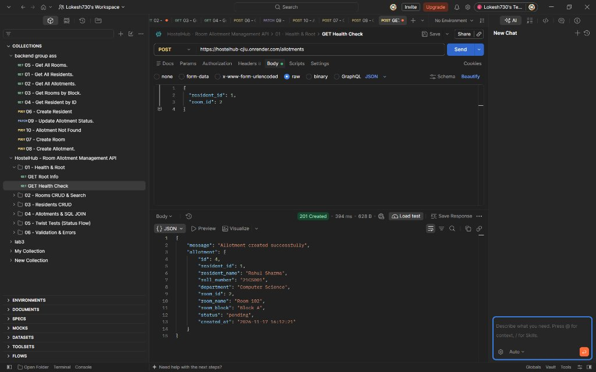
- **Target URL:** `https://hostelhub-cjlu.onrender.com/allotments`
- **HTTP Method:** `POST` | **Status Code:** `201 Created`
- **Request Payload:**
  ```json
  {
    "resident_id": 1,
    "room_id": 2
  }
  ```
- **Response Body:**
  ```json
  {
    "message": "Allotment created successfully",
    "allotment": {
      "id": 4,
      "resident_id": 1,
      "room_id": 2,
      "status": "pending",
      "created_at": "2026-11-17 17:28:43"
    }
  }
  ```
- **Verification:** **Client Brief Test 1** — Verified that every newly created allotment automatically receives `status: "pending"`.

---

#### P-05. Twist Test 2: Progress Status `pending` → `approved` (`PATCH /allotments/:id/status`)
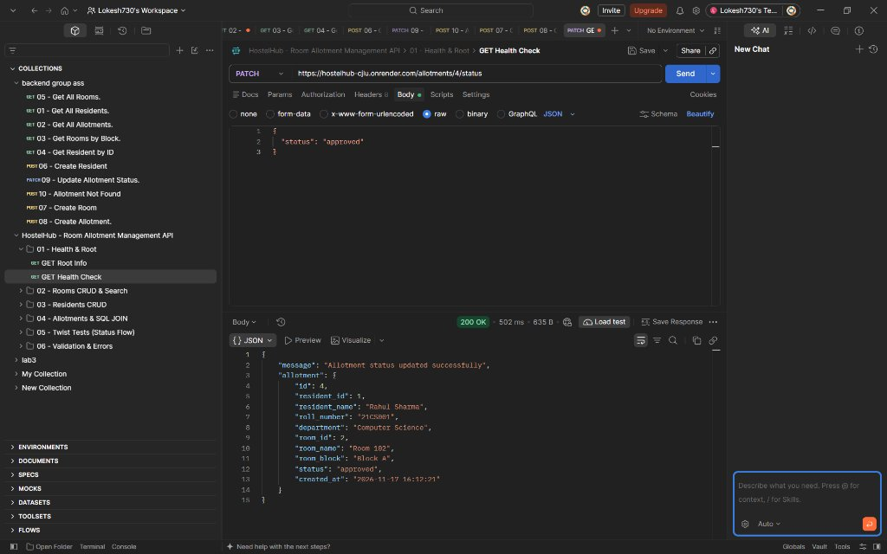
- **Target URL:** `https://hostelhub-cjlu.onrender.com/allotments/4/status`
- **HTTP Method:** `PATCH` | **Status Code:** `200 OK`
- **Request Payload:**
  ```json
  {
    "status": "approved"
  }
  ```
- **Response Body:**
  ```json
  {
    "message": "Status updated successfully",
    "allotment": {
      "id": 4,
      "resident_id": 1,
      "room_id": 2,
      "status": "approved",
      "created_at": "2026-11-17 17:28:43"
    }
  }
  ```
- **Verification:** **Client Brief Test 2** — Verified that status correctly advances one step forward from `pending` to `approved`.

---

#### P-06. Twist Test 3: Reject Backwards Status Transition `approved` → `pending` (`PATCH /allotments/:id/status`)
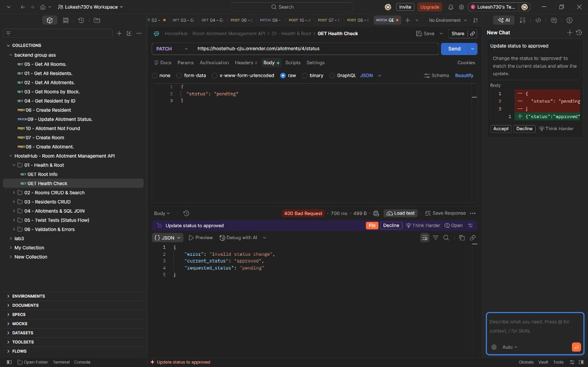
- **Target URL:** `https://hostelhub-cjlu.onrender.com/allotments/4/status`
- **HTTP Method:** `PATCH` | **Status Code:** `400 Bad Request`
- **Request Payload:**
  ```json
  {
    "status": "pending"
  }
  ```
- **Response Body:**
  ```json
  {
    "error": "Invalid status change",
    "current_status": "approved",
    "requested_status": "pending"
  }
  ```
- **Verification:** **Client Brief Test 3** — Strictly verifies that backward or disallowed state changes return HTTP `400 Bad Request` with the exact required error string `"Invalid status change"`.

---

#### P-07. Postman Input Validation Error Handling (`POST /rooms`)
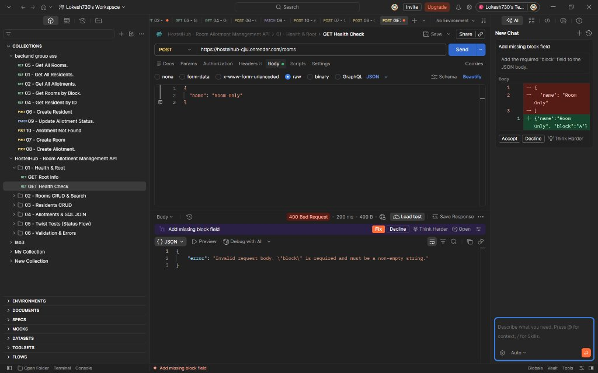
- **Target URL:** `https://hostelhub-cjlu.onrender.com/rooms`
- **HTTP Method:** `POST` | **Status Code:** `400 Bad Request`
- **Request Payload:** (missing required `block` field)
  ```json
  {
    "name": "Room Only"
  }
  ```
- **Response Body:**
  ```json
  {
    "error": "Missing required fields",
    "details": [
      "block is required and must be a non-empty string"
    ]
  }
  ```
- **Verification:** Confirms defensive payload validation, preventing corrupt records and providing descriptive feedback.

---

## 📦 Postman Collection Setup & Usage

The repository includes a ready-to-run Postman collection containing all routes, test assertions, and environment variables.

- **Collection File:** [`HostelHub-Postman-Collection.json`](HostelHub-Postman-Collection.json) *(also available in [`postman-screenshots/HostelHub-Postman-Collection.json`](postman-screenshots/HostelHub-Postman-Collection.json))*

### Collection Folders:
1. `01 - Health & Root` — Server status & uptime ping
2. `02 - Rooms CRUD & Search` — Complete rooms CRUD and block query parameter search
3. `03 - Residents CRUD` — Residents creation, listing, retrieval, update & deletion
4. `04 - Allotments & SQL JOIN` — Relational 3-table join queries and allotment retrieval
5. `05 - Twist Tests (Status Flow)` — Verification tests for Twist rules (Tests 1, 2, and 3)
6. `06 - Validation & Errors` — Missing field validations, duplicate uniqueness checks, and 404 handlers

### Import Instructions:
1. Open the **Postman** desktop application.
2. Click **Import** (top-left button).
3. Drag and drop or browse to select `HostelHub-Postman-Collection.json`.
4. Set the `baseUrl` collection variable to either:
   - Live Render: `https://hostelhub-cjlu.onrender.com`
   - Local: `http://localhost:3000`
5. Click **Run Collection** to execute all requests and view assertion results.

---

## 🧪 Automated Testing Suite

The repository contains an automated end-to-end test suite in `test.js` covering **40 individual assertions**.

```bash
npm test
```

### Test Suite Execution Output:
```text
====================================================
 HostelHub - Automated Test Suite
====================================================

[Database] SQLite connected & schema initialized at: hostelhub.db
[Test Server] Running at http://localhost:58741

--- 1. Server & Health Check Endpoints ---
  ✓ PASS: GET / returns 200 OK
  ✓ PASS: GET / returns server status
  ✓ PASS: GET /health returns 200 OK
  ✓ PASS: Unknown route returns 404 Not Found

--- 2. Rooms CRUD & Query Search (Client Brief) ---
  ✓ PASS: GET /rooms returns 200 OK
  ✓ PASS: GET /rooms returns array of rooms
  ✓ PASS: GET /rooms?block=Block A returns 200 OK
  ✓ PASS: Search by block returns matching rooms
  ✓ PASS: All filtered rooms belong to Block A
  ✓ PASS: POST /rooms returns 201 Created
  ✓ PASS: Created room has correct name
  ✓ PASS: GET /rooms/:id returns 200 OK
  ✓ PASS: Retrieved room matches requested ID
  ✓ PASS: PUT /rooms/:id returns 200 OK
  ✓ PASS: Updated room name is saved
  ✓ PASS: GET /rooms with invalid ID returns 400 Bad Request
  ✓ PASS: POST /rooms missing block returns 400 Bad Request
  ✓ PASS: GET /rooms/999999 returns 404 Not Found
  ✓ PASS: DELETE /rooms/:id returns 200 OK
  ✓ PASS: GET deleted room returns 404 Not Found

--- 3. Residents CRUD & Validation ---
  ✓ PASS: GET /residents returns 200 OK
  ✓ PASS: GET /residents returns array of residents
  ✓ PASS: POST /residents returns 201 Created
  ✓ PASS: GET /residents/:id returns 200 OK
  ✓ PASS: PUT /residents/:id returns 200 OK
  ✓ PASS: POST /residents with duplicate roll returns 409 Conflict

--- 4. SQL JOIN Endpoint (Resident & Room Names) ---
  ✓ PASS: GET /allotments returns 200 OK
  ✓ PASS: GET /allotments returns joined array
  ✓ PASS: Joined record contains resident_name
  ✓ PASS: Joined record contains room_name
  ✓ PASS: Joined record contains room_block
  ✓ PASS: Joined record contains status

--- 5. Twist Rule: Status Flow (Client Brief Tests 1, 2, 3) ---
  ✓ PASS: Test 1: Add an allotment returns 201 Created
  ✓ PASS: Test 1: Allotment starts as "pending"
  ✓ PASS: Test 2: pending -> approved returns 200 OK
  ✓ PASS: Allotment status updated to "approved"
  ✓ PASS: Test 3: approved -> pending returns 400 Bad Request
  ✓ PASS: Test 3: Returns exact message "Invalid status change"
  ✓ PASS: approved -> done returns 200 OK
  ✓ PASS: done -> pending returns 400 Bad Request ("Invalid status change")

====================================================
 Results: 40 / 40 tests passed (100% success rate).
====================================================
```

---

## 📜 Assessment Hand-in Checklist

- [x] **Express REST API**: Routes for `residents`, `rooms`, and `allotments` with proper error handling.
- [x] **Relational SQLite Database**: 3 interconnected tables with strict foreign key enforcement.
- [x] **Rooms CRUD Operations**: Implemented with accurate HTTP status codes (`200`, `201`, `400`, `404`, `409`).
- [x] **Search by Query Parameter**: Search rooms by block (`GET /rooms?block=Block%20A`).
- [x] **Relational SQL JOIN Endpoint**: Multi-table join returning allotment records with resident names, roll numbers, and room names.
- [x] **Twist Rule State Machine**: Enforced status lifecycle (`pending` → `approved` → `done`), rejecting invalid moves with `400 Bad Request` and `"Invalid status change"`.
- [x] **Twist Test 1 Verified**: Adding an allotment initializes status to `pending` with `201 Created`.
- [x] **Twist Test 2 Verified**: Progressing status from `pending` to `approved` returns `200 OK`.
- [x] **Twist Test 3 Verified**: Backwards transition `approved` to `pending` returns `400 Bad Request` with `"Invalid status change"`.
- [x] **Postman Collection Exported**: `HostelHub-Postman-Collection.json` organized into 6 test folders.
- [x] **Live Cloud Deployment**: Deployed on Render at `https://hostelhub-cjlu.onrender.com/`.
- [x] **11 Live Browser Proofs**: Embedded in README covering all GET routes, query search, and 404 handling.
- [x] **7 Postman Execution Proofs**: Embedded in README covering Health, JOIN, Room creation, Twist Tests 1–3, and validation errors.
- [x] **Automated Test Suite**: 40/40 passing unit/integration tests in `test.js`.

---

## 📄 License
This project is licensed under the MIT License.
